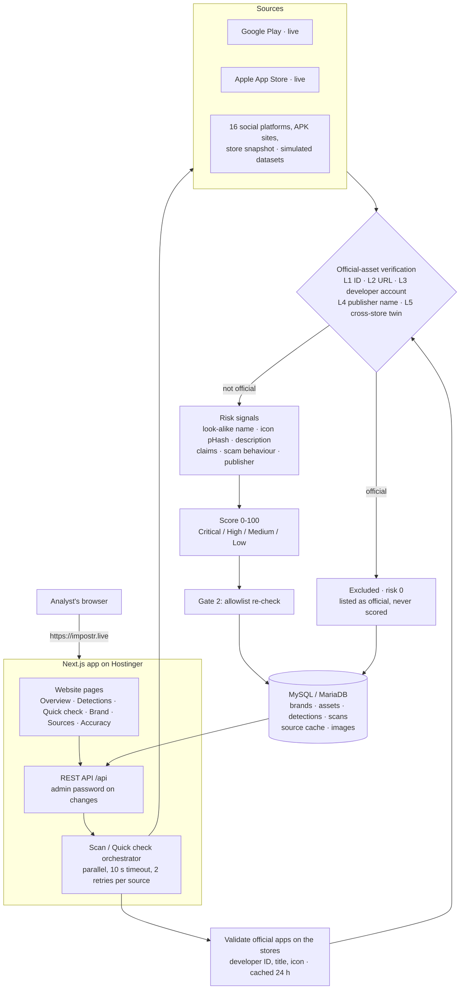

# BrandShield: Digital Risk Protection

Finds social-media profiles, brand pages and mobile apps that impersonate a registered brand, scores each one 0 to 100, and explains every flag. Official assets are allowlisted by ID and are never flagged.

Built for the Bytexl hackathon (Kampus.VC problem statement: Social & App Monitoring). Live at **https://impostr.live**.

## Architecture



One Next.js app serves the website, the API and the images:

| Part | Where | Stack |
| --- | --- | --- |
| Website | `frontend/src/app` | Next.js 15, TypeScript, Tailwind |
| API and detection engine | `frontend/src/server`, served at `/api` | Node.js (TypeScript), mysql2, sharp |
| Images | `/media`, stored in MySQL (`media_files`) | |
| Database | MySQL 8 or MariaDB; tables created automatically | |
| Reference engine | `backend/` | FastAPI, Python 3.11 (local only) |

The Python engine in `backend/` is the original implementation. The Node.js engine is a line-by-line port and is what runs in production. A parity check runs the labelled test set through both and compares every row (outcome, status, score, severity, reason). They match on all 71 cases, and live Quick checks return identical official apps and scores. Logo similarity reproduces Pillow's resize and colour conversion exactly, so perceptual hashes are bit-identical.

**Detection pipeline (allowlist-first)** — `src/server/services/scan.ts`, `services/search.ts`:

1. **Validate official assets.** Each official app in the brand profile is looked up on its store (Google Play detail, App Store lookup); its developer account ID, store title, publisher and icon are recorded (cached 24 h).
2. **Build the allowlist and verified identities:** official IDs/handles, developer account IDs per store, normalised publisher names (`PhonePe Pvt. Ltd.` = `PHONEPE PRIVATE LIMITED` = `PhonePe`), package namespaces, official icons.
3. **Collect candidates** from every source. Live stores fall back to their last good results when down, labelled CACHED; curated datasets are labelled SIMULATED.
4. **Official-asset verification before any scoring** (`detection/official.ts`):
   - L1 exact official ID / handle, L2 official URL → OFFICIAL
   - L3 published by a verified official developer account → OFFICIAL (finds official variants)
   - L4 official publisher name + supporting metadata, with no contradicting developer ID and no scam signals → LIKELY_OFFICIAL
   - L5 same title as a verified official app on the other store, matching icon, established audience → LIKELY_OFFICIAL
   Official candidates stop here: risk 0, never scored.
5. **Risk signals and scoring** for everything else: look-alike name, icon (pHash, mirror-aware), description, impersonation claims, scam behaviour, publisher mismatch (only when an official publisher is on record: unknown is not a mismatch). Status: SUSPICIOUS / LOOKALIKE / MENTION.
6. **Gate 2** re-checks the allowlist before saving. No brand-specific code anywhere: brands are data.

**Accuracy** (`GET /api/accuracy`, Accuracy page): a labelled set of 71 cases (`frontend/data/labelled_cases.json`) run through the same engine. Current result: 0 of 18 official assets flagged, precision 1.00, recall 0.925.

**Sources**

| Source | Mode |
| --- | --- |
| Google Play | Live (`google-play-scraper`) |
| Apple App Store | Live (iTunes Search API) |
| 16 social platforms (Instagram, Facebook, WhatsApp, X, Threads, LinkedIn, Telegram, Snapchat, YouTube, ShareChat, Moj, Josh, Pinterest, Reddit, Quora, Discord) | Simulated: curated dataset (no open search APIs) |
| APK mirror sites | Simulated: curated dataset |
| Store snapshot (simulated) | Simulated: curated store fakes for the demo brands (ZentraPay is fictional; PhonePe fakes are made up) |

## Run locally

```bash
cd frontend
npm install
# frontend/.env.local (not committed):
#   MYSQL_HOST=localhost  MYSQL_PORT=3306  MYSQL_USER=root  MYSQL_PASSWORD=...  MYSQL_DB=brandshield
npm run dev                       # http://localhost:3000
```

On first start the API creates the database and tables, seeds the demo brands and runs a scan.

The Python reference engine is optional: see `backend/.env.example`, then `python -m uvicorn app.main:app --port 8100`. Set `NEXT_PUBLIC_API_URL=http://localhost:8100` to point the website at it.

## Deploy

Hostinger Node.js app from GitHub (root directory `frontend`), database on Hostinger. Step-by-step in [DEPLOY.md](DEPLOY.md).

## Tests

```bash
cd frontend
npm test                          # 105 tests (Vitest)
```

Engine unit tests, allowlist-first regression tests, connector parsing on recorded store responses, and end-to-end API tests against MySQL (separate `brandshield_test_node` schema, dropped afterwards).

Parity with the Python reference engine:

```bash
backend\.venv\Scripts\python backend\eval_dump.py > py.json
cd frontend && npx tsx scripts/parity.ts ../py.json
```

The Python suite (`cd backend && .venv\Scripts\python -m pytest -q`, 101 tests) still passes.

## Networks that inspect HTTPS

Some campus and corporate firewalls (for example FortiGate) re-sign HTTPS with their own certificate. The live store sources then fail and show as Unavailable. Get the firewall's CA certificate (PEM) and start Node with `NODE_EXTRA_CA_CERTS=path\to\ca.pem` (Python: `CA_BUNDLE` in `backend/.env`). Certificate verification is never turned off.
