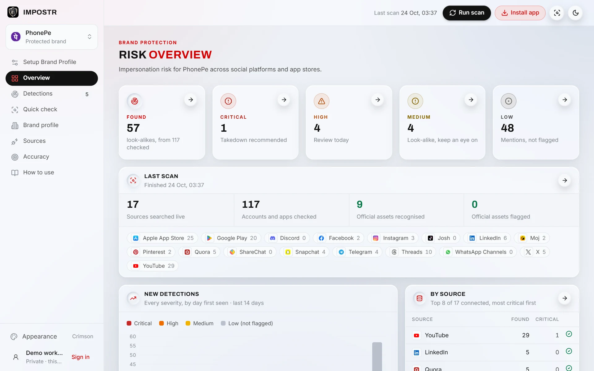
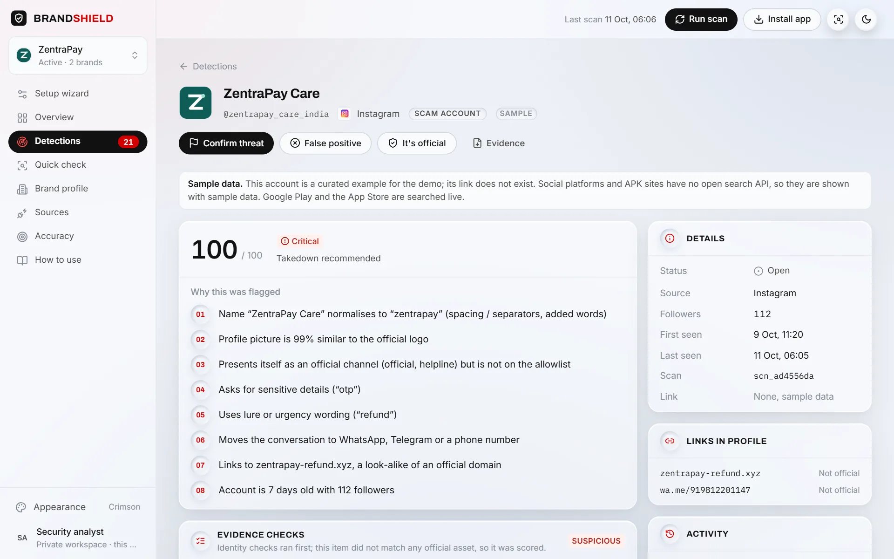
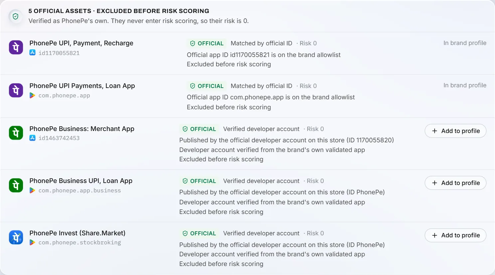
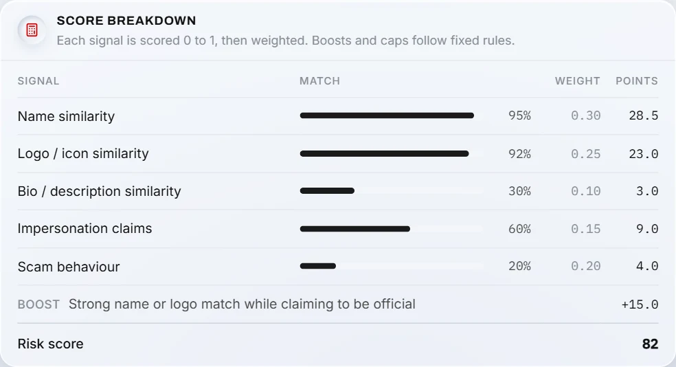
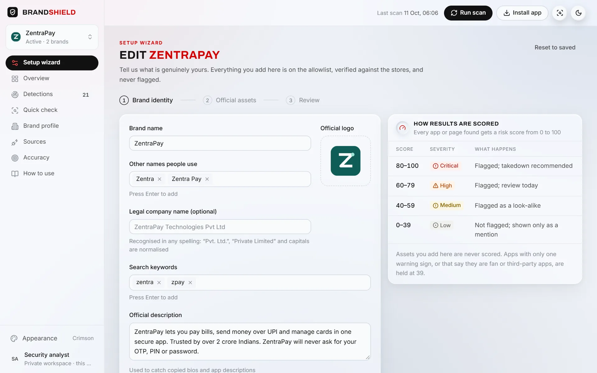
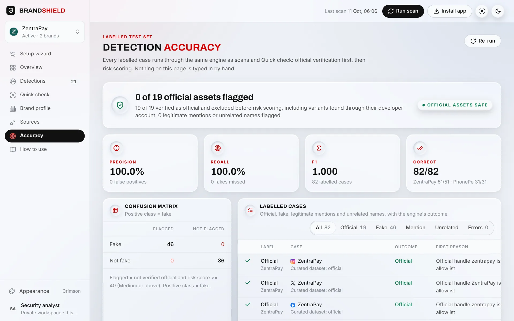
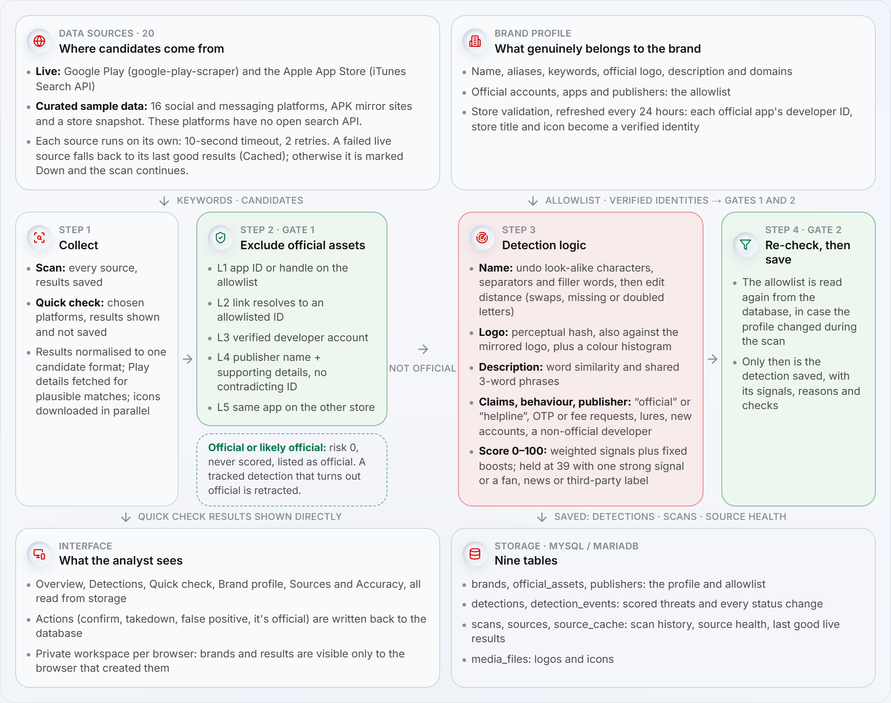

# IMPOSTR: Digital Risk Protection for Social & App Monitoring

IMPOSTR finds fake social-media profiles, fake brand pages, scam accounts and look-alike mobile apps that impersonate a brand. It scores each one from 0 to 100 and explains every flag in plain words. The brand's own accounts and apps are recognised first and are never flagged.

Built for the ByteXL HackXlerate hackathon, Kampus.VC challenge: **Digital Risk Protection: Social & App Monitoring**.

## Submission

| Deliverable | Where |
| --- | --- |
| Working prototype | **https://impostr.live**, open to everyone: choose **Continue as demo** (no account needed) |
| Demo video (5 min) | In the app: **How to use** (plays first, with playback speeds). File: [`frontend/public/help/impostr-demo.mp4`](frontend/public/help/impostr-demo.mp4) |
| Architecture diagram | In the app under How to use → **Architecture**, and below: [`docs/architecture.png`](docs/architecture.png) |
| Step-by-step guide | How to use tab: 26 slides with screenshots of every feature |

**Try it in two minutes:** open https://impostr.live, choose **Continue as demo** (three real demo brands: PhonePe, SBI and Airtel), press **Run scan** and wait about a minute, then open **Detections** and click the top row: **Confirm threat**, then **Request takedown** opens a ready-made takedown letter. In **Quick check**, search `PhonePe` (official apps recognised, look-alikes scored), then `Paytm` (an unregistered brand, which IMPOSTR offers to register from its real store apps). For affiliate-marketing misuse, switch to Airtel and search `Airtel recharge offer`.

**Verify without a browser.** These live links return JSON:
- [`/api/accuracy`](https://impostr.live/api/accuracy) runs the labelled PhonePe test set: 31/31 correct, 0 of 8 official assets flagged.
- [`/api/search?query=PhonePe&platforms=google_play,app_store`](https://impostr.live/api/search?query=PhonePe&platforms=google_play,app_store) is a live app-store search. Official apps appear under `official` with risk 0, and look-alikes appear under `results` with reasons, signals and evidence checks.
- [`/api/search?query=paytm&platforms=telegram,instagram,facebook,x,youtube`](https://impostr.live/api/search?query=paytm&platforms=telegram,instagram,facebook,x,youtube) runs a live social search for impersonation and scam accounts, with official accounts excluded.
- [`/api/search?query=ph0nepe_support`](https://impostr.live/api/search?query=ph0nepe_support) shows the look-alike name analysis, step by step, in `nameAnalysis`.
- [`/api/sources`](https://impostr.live/api/sources) lists every source, its mode (live, or not connected) and its health.

## Screenshots

| | |
| --- | --- |
|  **Overview:** risk at a glance, with 0 official assets flagged |  **A detection:** score, plain-language reasons, details |
|  **Quick check (live stores):** PhonePe's own apps recognised and excluded |  **Score breakdown:** signals × weights + boosts |
|  **Setup Brand Profile:** the legitimate assets |  **Performance:** 31/31 correct, 0 of 8 official assets flagged |

## How it meets the challenge

| Criterion | What IMPOSTR does |
| --- | --- |
| **Brand Profile** (15%) | Three-step **Setup Brand Profile**: name, aliases, official logo, description, keywords, official social accounts, official apps, publisher and domains. Each official app is **validated on its store** (developer ID, store title, icon), and the profile drives every check: names for look-alike matching, the logo for image matching, the description for copied text, and the allowlist before any scoring. |
| **Social Media Monitoring** (30%) | Impersonation accounts, fake brand pages and scam profiles across 15 social and messaging platforms. Each is detected by look-alike name, copied logo (including mirrored and recoloured copies), copied bio, "official / helpline" claims and scam behaviour (OTP or fee requests, lures, moving to WhatsApp, new accounts). **Official accounts are never flagged.** |
| **App Store Monitoring** (30%) | Google Play and the App Store are **searched live**. It catches similar names, copied icons, a **different developer or publisher** (including fakes that copy the company name under another developer account) and resembling descriptions. The brand's official apps and their sibling apps are recognised by app ID, verified developer account and publisher, so **official apps are never flagged**. |
| **User Experience** (15%) | Setup in three steps, or register a brand straight from a search. Detections give plain-language reasons, a score breakdown and evidence checks, with actions to confirm, request a takedown, mark a false positive or mark official. **Request takedown** opens a ready-made, editable letter filled in from the evidence, with a link to the platform's own impersonation or trademark report form; nothing is sent automatically. **Unavailable sources are handled gracefully:** each source has its own timeout and retries, falls back to cached results, and otherwise shows as Down while the scan completes (try **Pause source** on Sources); web search switches from Brave to Serper by itself when one provider runs out of credit. Works on any phone and installs as an app. |
| **Look-alike names** (bonus) | Character swaps, missing or doubled letters, look-alike characters (`0`→`o`, `3`→`e`, Cyrillic letters), added words (`phonepe_support_india`) and spacing changes (`phone.pe`). It avoids over-flagging: ordinary words, other companies' names and openly labelled fan, news or third-party pages stay Low. |
| **Affiliate marketing** (judge's suggestion) | Accounts and pages that use the brand to push referral or promo codes, route through affiliate networks (EarnKaro, Cuelinks, vCommission and others) or carry affiliate tracking links (`?ref=`, `?aff=`) are shown with that reason. Sharing a referral code is not fraud by itself, so it stays Low unless it comes with impersonation; approved partners can be marked official. |

**Measured accuracy** (Performance tab, recomputed live): 31 hand-labelled PhonePe cases, including 11 held out from rule-writing. All **31 of 31 are correct**: precision 100%, recall 100%, and **0 of 8 official assets flagged**. The automated tests also run a larger fixture set of 82 cases (curated look-alike accounts and apps of a fictional test brand), with the same result.

## Architecture



The pipeline is allowlist-first, in `frontend/src/server/services/scan.ts` and `services/search.ts`:

1. **Validate the profile.** Each official app is looked up on its store. Its developer account ID, store title and icon become a verified identity, cached for 24 hours.
2. **Collect candidates** from 17 sources in parallel, each with a 10-second timeout and 2 retries. A failed live store falls back to its last good results (shown as Cached). Any other failed source is shown as Down, and the scan carries on.
3. **Gate 1: exclude official assets before any scoring** (`detection/official.ts`):
   - **L1:** the exact official ID or handle.
   - **L2:** an official URL.
   - **L3:** a verified developer account.
   - **L4:** the official publisher name plus supporting details, with no contradicting developer ID.
   - **L5:** the same app on the other store.

   Anything official is reported with risk 0 and is never scored.
4. **Detection logic** for everything else:
   - **Signals:** look-alike name (`detection/lookalike.ts`), logo perceptual hash with a mirror check and colour histogram (`images.ts`), description similarity, claims, scam behaviour and publisher (`text.ts`, `signals.ts`).
   - **Score:** the signals are weighted and fixed boosts added, giving 0 to 100 (`scoring.ts`).
   - **Cap at 39:** a single strong signal on its own, or an openly labelled fan, news or third-party page, is held at 39.
5. **Gate 2:** the allowlist is re-checked in the database just before a detection is saved.

No brand is hard-coded: brands are data, and the same rules apply to every brand.

**Storage** (MySQL / MariaDB, 9 tables, created automatically on first start):

| Tables | What they hold |
| --- | --- |
| `brands`, `official_assets`, `publishers` | The brand profile and allowlist |
| `detections`, `detection_events` | Scored detections and their status history |
| `scans`, `sources`, `source_cache` | Scan runs, source health, and the last good live results |
| `media_files` | Logos and icons |

**Sources:**

| Source | Mode |
| --- | --- |
| Google Play | Live (`google-play-scraper`) |
| Apple App Store | Live (iTunes Search API) |
| Telegram | Live: public t.me pages for usernames built from the brand name (no key needed) |
| YouTube | Live: YouTube Data API v3 (`YOUTUBE_API_KEY`) |
| Instagram, Facebook, X, LinkedIn, Threads, Pinterest, Quora, Snapchat, ShareChat, WhatsApp (public channels and group invites), Moj, Josh | Live: web search, `site:` queries per platform for public profiles and pages. Brave Search (`BRAVE_SEARCH_API_KEY`) first, Serper / Google results (`SERPER_API_KEY`) when Brave is out of credit or fails; each query's results are shared by all workspaces for 12 hours |
| Discord | Live: invites found by web search, each checked with Discord's public invite lookup (server name, description, member count; expired invites dropped) |

There is no sample data. A source whose API key is not set is shown as **Not connected** and returns nothing. Set the keys as environment variables (hPanel → Environment variables, or `.env.local`); never commit them. The automated tests run with `DATA_MODE=fixtures`, where curated fixtures stand in for the social sources so the tests are repeatable and offline.

**Workspaces and accounts.** Each browser gets its own private workspace through an HTTP-only cookie (Continue as demo), or signs in to an account that keeps its workspace. A workspace starts with three real demo brands, **PhonePe** (active), **SBI** and **Airtel**: their official apps (checked on Google Play and the App Store) and the official accounts listed on their own websites. Anything a visitor registers, scans or marks is visible only in their own workspace.

## Tech stack

| Part | Where | Stack |
| --- | --- | --- |
| Web app and API | `frontend/` (screens in `src/app`, engine in `src/server`, served at `/api`) | Next.js 15, React 19, TypeScript, Tailwind CSS, sharp, mysql2 |
| Database | Hostinger MariaDB (MySQL 8 locally) | |
| Reference engine | `backend/` | Python 3.11, FastAPI. Gives the same result on every labelled case. |
| Hosting | Hostinger Node.js app, auto-deployed from this repo's `main` branch | |

## Run locally

```bash
cd frontend
npm install
# frontend/.env.local (not committed):
#   MYSQL_HOST=localhost  MYSQL_PORT=3306  MYSQL_USER=root  MYSQL_PASSWORD=...  MYSQL_DB=brandshield
npm run dev                       # http://localhost:3000
```

On first start the app creates the database tables; each new workspace gets the demo brands, and a scan runs when the user presses Run scan. Deployment steps are in [`DEPLOY.md`](DEPLOY.md).

## Tests

```bash
cd frontend && npm test           # 110 tests (Vitest)
cd backend && python -m pytest -q # 104 tests (Python reference engine)
```

The tests cover:
- engine unit tests and allowlist-first regression tests;
- connector parsing on recorded store responses;
- end-to-end API tests against MySQL;
- a parity check, `frontend/scripts/parity.ts`, which runs the 82-case fixture set through both engines and compares every row (run it with `DATA_MODE=fixtures`).

## Security

No credentials are stored in the repository. The database settings come from environment variables (hPanel on Hostinger, `.env.local` locally), and `.env` files are ignored by git.
